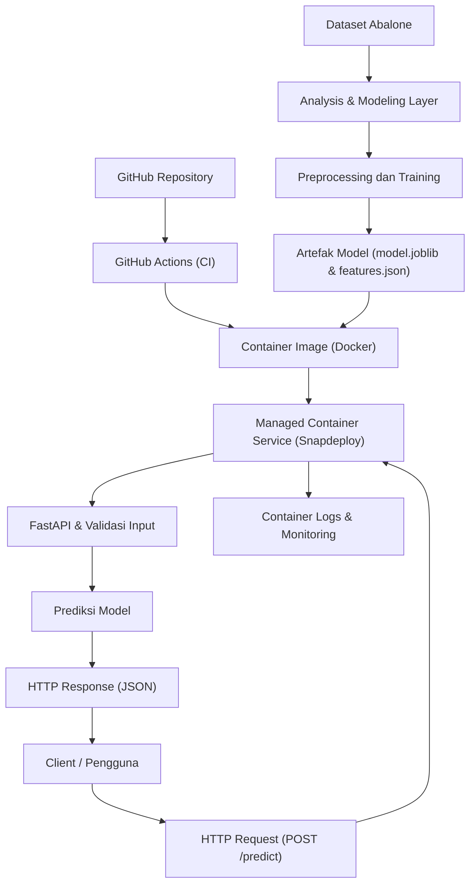

# Arsitektur Sistem

## 1. Gambaran Umum

Proyek Model Prediktif sebagai Cloud API (Topik 2) dikembangkan untuk menyediakan layanan prediksi jumlah cincin (*Rings*) pada abalone berdasarkan karakteristik fisiknya menggunakan service model Container.

Sistem dirancang dengan tiga bagian utama, yaitu Analysis & Modeling Layer, API Layer, dan Infrastructure & Operations Layer.

## 2. Diagram Arsitektur

Diagram tersebut menggambarkan alur lengkap sistem mulai dari pemodelan, pengujian otomatis CI, deployment container di Snapdeploy, hingga pemantauan layanan.

## 3. Komponen Arsitektur

### 3.1 Analysis & Modeling Layer

Layer ini bertanggung jawab atas pemuatan data, eksplorasi, preprocessing, pelatihan, evaluasi, dan penyimpanan model.

Komponen yang telah tersedia:

- `src/analysis/data_loader.py`: modul pemuatan data.
- `src/analysis/eda_v2.ipynb`: notebook eksplorasi data.
- `src/analysis/preprocess.py`: modul preprocessing.
- `src/analysis/train.py`: proses pelatihan dan evaluasi model.
- `src/app/model/model.joblib`: artefak model (`GradientBoostingRegressor`).
- `src/app/model/features.json`: informasi fitur model.

### 3.2 API Layer

API Layer berfungsi sebagai penghubung antara pengguna dan model prediktif menggunakan framework FastAPI dan Uvicorn:

1. Endpoint `GET /health` memeriksa status layanan dan kesiapan model (`{"status": "ok", "model_version": "v1"}`).
2. Endpoint `POST /predict` menerima 8 fitur karakteristik abalone dalam format JSON (`Sex`, `Length`, `Diameter`, `Height`, `Whole weight`, `Shucked weight`, `Viscera weight`, `Shell weight`).
3. API memvalidasi input (mengembalikan status `400` jika body/fitur kosong, dan `422` jika fitur tidak lengkap, tipe salah, atau kategori `Sex` di luar `"M"`, `"F"`, `"I"`).
4. Data diteruskan ke pipeline model (`StandardScaler` dan `GradientBoostingRegressor`).
5. API mengembalikan hasil prediksi jumlah cincin beserta versi model dalam format JSON.

### 3.3 Infrastructure & Operations Layer

Infrastructure & Operations Layer bertanggung jawab menyediakan lingkungan eksekusi container, otomatisasi, dan pemantauan layanan:

- **Pengemasan Container (`Dockerfile`):** Membungkus aplikasi FastAPI, Python 3.11, dependensi (`scikit-learn==1.9.1`), dan artefak model ke dalam satu container image.
- **CI/CD:** Menggunakan GitHub Actions (`.github/workflows/ci.yml`) untuk menjalankan pengujian otomatis (`pytest`) dan verifikasi build image pada setiap push/PR, serta integrasi deployment otomatis ke Snapdeploy dari branch `main`.
- **Runtime Cloud (Snapdeploy):** Menjalankan aplikasi container pada paket gratis (*Free Tier*) Snapdeploy di alamat publik **`https://cc-kelompok2-c103e.containers.snapdeploy.app`** sebagai alternatif pengganti Google Cloud Run karena tidak memerlukan kartu kredit untuk aktivasi billing, dengan dukungan langsung terhadap deployment berbasis `Dockerfile`.
- **Monitoring & Logging:** Mencatat log permintaan secara terstruktur ke `stdout` (dapat dipantau di dashboard Snapdeploy), serta melakukan pengujian kesehatan endpoint `/health` dan pengujian beban (*load test* via `scripts/load_test.py`).

## 4. Pemilihan Service Model dan Perbandingan Alternatif

Layanan ini menerapkan **service model Container** karena aplikasi dikemas sebagai Docker container dan dijalankan di atas platform terkelola (**Snapdeploy**) tanpa perlu mengelola sistem operasi server secara manual.

Berikut perbandingan teknis dan biaya antara **Managed Container (Snapdeploy)** dengan alternatif **Virtual Machine (VM)**:

| Aspek | Managed Container / Snapdeploy (Pilihan Kelompok) | Virtual Machine / VM (Alternatif) |
|---|---|---|
| Pengelolaan Server | Dikelola otomatis oleh penyedia platform; tidak perlu mengurus instalasi OS, web server, atau patch keamanan manual. | Harus dikelola sendiri mulai dari instalasi OS, Python, runtime, hingga konfigurasi jaringan dan keamanan. |
| Konsistensi Lingkungan | Sangat konsisten karena seluruh library (`scikit-learn==1.9.1`) terkunci di dalam Docker image. | Berisiko terjadi perbedaan versi library antara laptop lokal dan server jika tidak dikonfigurasi manual. |
| Perilaku Operasional & Skalabilitas | Berjalan pada container terkelola dengan kuota resource tetap (Free Tier) dan berpotensi masuk mode *sleep/idle* jika lama tidak menerima trafik. | Instance menyala terus-menerus 24/7 selama tidak dimatikan manual. |
| Efisiensi Biaya | Gratis ($0) pada paket Free Tier tanpa memerlukan kartu kredit, sehingga sangat aman dari risiko tagihan tak terduga. | Berbayar per jam (*pay-per-uptime*) dan umumnya mewajibkan kartu kredit/deposit awal. |

**Alasan Pemilihan:** Managed Container melalui Snapdeploy dipilih karena menjamin konsistensi dependensi model melalui Docker, mendukung otomatisasi deployment dari GitHub, dan menghilangkan risiko biaya berlebih selama masa pengujian serta demo UAS.

## 5. Alur Data Sistem

1. Dataset Abalone digunakan sebagai sumber data analisis dan pemodelan.
2. Data melalui tahapan preprocessing dan pelatihan model.
3. Model terpilih (`GradientBoostingRegressor`) disimpan sebagai artefak `model.joblib`.
4. Kode aplikasi dan model dikemas menjadi container image melalui Docker dan divalidasi oleh GitHub Actions.
5. Container dijalankan di Snapdeploy (`https://cc-kelompok2-c103e.containers.snapdeploy.app`) dan memuat model ke memori saat startup.
6. Pengguna mengirimkan data fitur melalui `POST /predict`.
7. API memvalidasi input, menjalankan prediksi melalui pipeline model, dan mengembalikan respons JSON.
8. Sistem mencatat log permintaan dan status kesehatan layanan pada dashboard operasional.

## 6. Pembagian Tanggung Jawab

| Layer | Tanggung Jawab | Peran |
|---|---|---|
| Analysis & Modeling | Pemuatan data, EDA, preprocessing, pelatihan, evaluasi, dan artefak model | Orang 1 |
| Analysis & Documentation | Dokumentasi analisis, kontrak API, README, bantuan arsitektur, dan AI disclosure | Orang 2 |
| API | Implementasi endpoint FastAPI, test API, Dockerfile, deploy awal, dan runbook | Orang 3 |
| Infrastructure & Operations | Otomatisasi CI/CD, diagram arsitektur, monitoring, load test, laporan biaya, dan keamanan | Orang 4 |

## 7. Integrasi Antarlayer

Integrasi dilakukan dengan memastikan artefak model dapat digunakan oleh API dan layanan API dapat dijalankan pada lingkungan infrastruktur yang disiapkan.

Hal-hal yang diperiksa pada tahap integrasi:

- API menggunakan artefak model yang benar (`model.joblib` dan `features.json`).
- Nama dan urutan fitur sesuai dengan skema model.
- Format input dan kode error API (`400` dan `422`) sesuai dengan kontrak API.
- Preprocessing tidak dilakukan secara ganda di luar pipeline model.
- Versi `scikit-learn==1.9.1` konsisten antara tahap training dan container API.
- Konfigurasi deployment pada Snapdeploy sesuai dengan port dan kebutuhan aplikasi.
- Dokumentasi sesuai dengan implementasi aktual setelah deployment.

## 8. Status Dokumentasi

Dokumen ini telah disesuaikan dan diverifikasi terhadap implementasi aktual setelah proses deployment selesai dijalankan:

- **URL Layanan Publik (*Base URL*):** `https://cc-kelompok2-c103e.containers.snapdeploy.app`
- **Swagger UI (*API Docs*):** `https://cc-kelompok2-c103e.containers.snapdeploy.app/docs`
- **Status Verifikasi:** Endpoint `GET /health` dan `POST /predict` telah teruji aktif (`200 OK`), serta hasil pengujian beban (*load test*) dan bukti tangkapan layar telah terdokumentasi di `docs/security-scalability.md` dan `docs/evidence/`.
