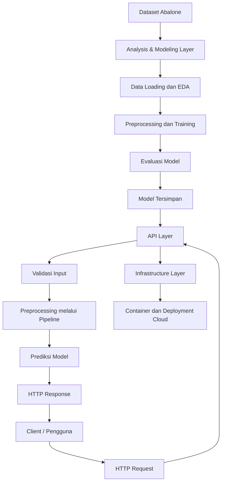

# Arsitektur Sistem

## 1. Gambaran Umum

Proyek Model Prediktif sebagai Cloud API dikembangkan untuk menyediakan layanan prediksi jumlah cincin (*Rings*) pada abalone berdasarkan karakteristik fisiknya.

Sistem dirancang dengan tiga bagian utama, yaitu Analysis & Modeling Layer, API Layer, dan Infrastructure Layer.

## 2. Diagram Arsitektur

Diagram tersebut menggambarkan rancangan alur sistem. Detail implementasi API dan infrastruktur akan disesuaikan setelah proses pengembangan masing-masing layer selesai.

## 3. Komponen Arsitektur

### 3.1 Analysis & Modeling Layer

Layer ini bertanggung jawab atas pemuatan data, eksplorasi, preprocessing, pelatihan, evaluasi, dan penyimpanan model.

Komponen yang telah tersedia:

- `src/analysis/data_loader.py`: modul pemuatan data.
- `src/analysis/eda_v2.ipynb`: notebook eksplorasi data.
- `src/analysis/preprocess.py`: modul preprocessing.
- `src/analysis/train.py`: proses pelatihan dan evaluasi model.
- `src/app/model/model.joblib`: artefak model.
- `src/app/model/features.json`: informasi fitur model.

Model yang dipilih berdasarkan evaluasi validasi silang adalah `GradientBoostingRegressor`.

### 3.2 API Layer

API Layer dirancang sebagai penghubung antara pengguna dan model prediktif.

Alur yang direncanakan:

1. Pengguna mengirimkan data karakteristik abalone melalui request.
2. API menerima dan memvalidasi data masukan.
3. Data diteruskan ke model yang telah disimpan.
4. Model menghasilkan prediksi jumlah cincin.
5. API mengembalikan hasil prediksi kepada pengguna.

Detail endpoint, framework, struktur aplikasi, dan mekanisme pemuatan model akan disesuaikan dengan implementasi Orang 3.

### 3.3 Infrastructure Layer

Infrastructure Layer bertanggung jawab untuk menyediakan lingkungan eksekusi dan deployment layanan.

Komponen yang direncanakan meliputi:

- Pengelolaan dependensi aplikasi.
- Pengemasan aplikasi ke dalam container apabila digunakan.
- Konfigurasi lingkungan deployment.
- Penyediaan akses layanan.
- Pengelolaan dan pembersihan resource cloud.

Detail teknologi dan konfigurasi akan disesuaikan dengan implementasi Orang 4.

## 4. Alur Data Sistem

Secara konseptual, alur data sistem adalah sebagai berikut:

1. Dataset Abalone digunakan sebagai sumber data analisis dan pemodelan.
2. Data melalui tahapan preprocessing.
3. Model dilatih dan dievaluasi menggunakan data latih dan data uji.
4. Model terpilih disimpan sebagai artefak `model.joblib`.
5. API dirancang untuk memuat model dan menerima data dari pengguna.
6. Data masukan divalidasi dan diproses menggunakan pipeline model.
7. Model menghasilkan nilai prediksi yang dikembalikan kepada pengguna.
8. Layanan API dijalankan pada lingkungan infrastruktur yang disiapkan.

## 5. Pembagian Tanggung Jawab

| Layer | Tanggung Jawab | Peran |
|---|---|---|
| Analysis & Modeling | Pemuatan data, EDA, preprocessing, pelatihan, evaluasi, dan artefak model | Orang 1 |
| Analysis & Documentation | Dokumentasi analisis, kontrak API, README, arsitektur, dan koordinasi review | Orang 2 |
| API | Implementasi endpoint dan integrasi model ke layanan API | Orang 3 |
| Infrastructure | Pengemasan, konfigurasi, dan deployment layanan | Orang 4 |

## 6. Integrasi Antarlayer

Integrasi dilakukan dengan memastikan artefak model dapat digunakan oleh API dan layanan API dapat dijalankan pada lingkungan infrastruktur yang disiapkan.

Hal-hal yang perlu diperiksa pada tahap integrasi:

- API menggunakan artefak model yang benar.
- Nama dan urutan fitur sesuai dengan skema model.
- Format input API sesuai dengan kontrak API.
- Validasi input sesuai dengan ketentuan yang disepakati.
- Preprocessing tidak dilakukan secara ganda di luar pipeline model.
- Response API sesuai dengan format yang ditetapkan.
- Konfigurasi deployment sesuai dengan kebutuhan aplikasi.
- Dokumentasi sesuai dengan implementasi aktual.

## 7. Status Dokumentasi

Dokumen ini merupakan rancangan awal berdasarkan komponen Analysis & Modeling yang telah tersedia dan pembagian tugas kelompok.

Bagian API Layer dan Infrastructure Layer masih perlu diperbarui setelah implementasi Orang 3 dan Orang 4 tersedia. Diagram, alur integrasi, dan informasi deployment harus ditinjau kembali sebelum dokumen dinyatakan final.